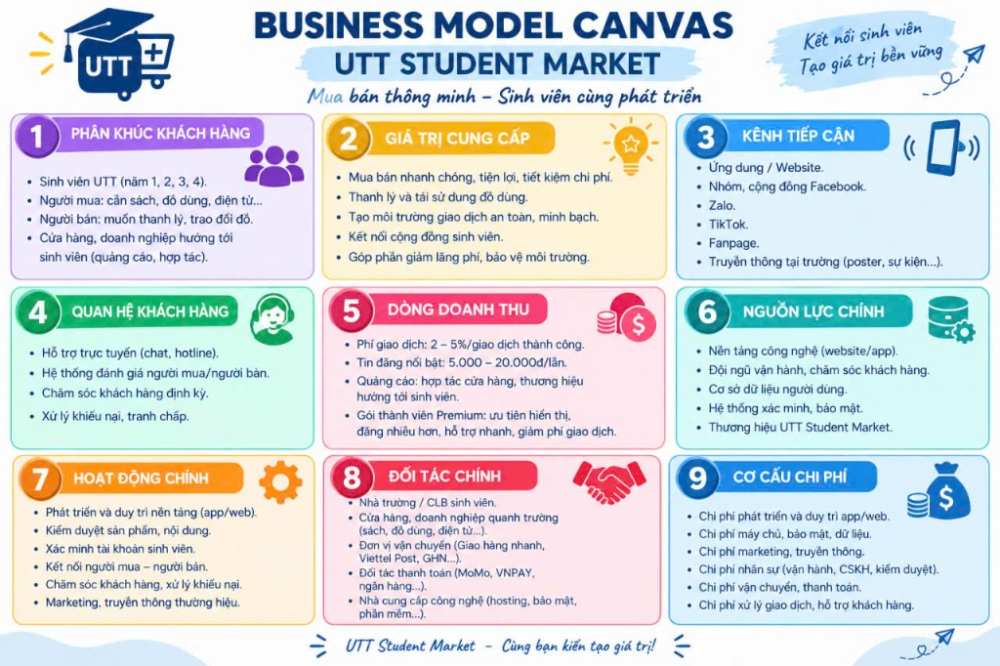
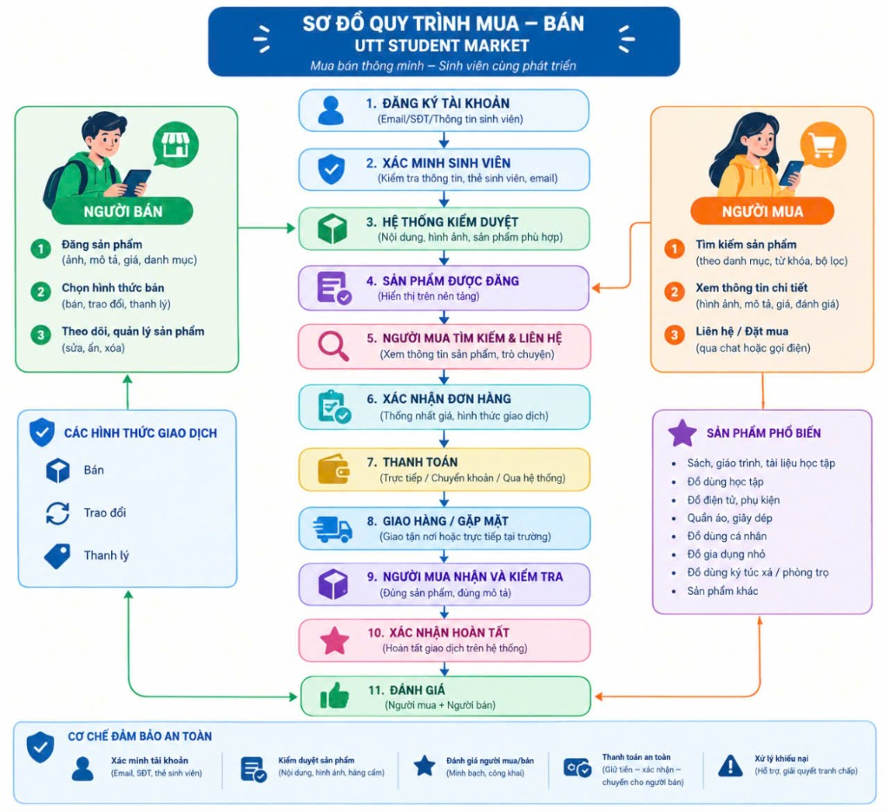

# 🎓 UTT STUDENT MARKET
> **"Mua bán thông minh – Sinh viên cùng phát triển"**  
> *Dự án Khởi nghiệp Nhóm 4 — Trường Đại học Công nghệ Giao thông Vận tải (UTT)*


---

## 📌 1. Giới Thiệu Dự Án
**UTT Student Market** là nền tảng thương mại điện tử và chợ sinh viên số được thiết kế chuyên biệt cho cộng đồng sinh viên **Trường Đại học Công nghệ Giao thông Vận tải (UTT)** trên cả 3 cơ sở:
* 📍 **Cơ sở Hà Nội:** Số 54 Triều Khúc, Thanh Xuân, Hà Nội
* 📍 **Cơ sở Vĩnh Yên:** Phường Đồng Tâm, TP. Vĩnh Yên, Vĩnh Phúc
* 📍 **Cơ sở Thái Nguyên:** Phường Tân Thịnh, TP. Thái Nguyên

Dự án giải quyết vấn đề phân tán thông tin, bài đăng trôi trên mạng xã hội và nguy cơ lừa đảo cọc tiền bằng cách cung cấp môi trường mua bán minh bạch, 100% người dùng được xác thực qua thẻ sinh viên hoặc email trường.

---

## 🚀 2. Tính Năng Nổi Bật

### 🛍️ Sàn Giao Dịch Sinh Viên (Live Storefront)
* **Bộ lọc thông minh:** Tìm kiếm theo từ khóa, lọc theo 3 cơ sở đào tạo của UTT.
* **7 Nhóm danh mục thiết yếu:**
  1. 📚 Giáo trình & Sách học tập UTT
  2. 📐 Dụng cụ & Máy tính kỹ thuật (Casio FX-580VN X, thước kỹ thuật...)
  3. 💻 Thiết bị điện tử (Bàn phím cơ, tai nghe bluetooth...)
  4. 🛏️ Đồ dùng phòng trọ & Ký túc xá
  5. 👕 Quần áo & Đồng phục UTT
  6. 🎁 Đồ 0đ (Cho / Tặng / Trao đổi miễn phí)
* **Đăng tin trực tuyến:** Form đăng thanh lý đồ dùng với kiểm duyệt thông tin thực tế.
* **Chat trao đổi trực tiếp:** Nhắn tin hẹn gặp nhận đồ ngay tại sảnh giảng đường, thư viện trường UTT.

### 📋 Cổng Báo Cáo Ý Tưởng & Mô Hình Dự Án
* **Business Model Canvas (9 Khối):** Tích hợp Infographic gốc và lưới dữ liệu 9 trụ cột chi tiết.
* **Quy trình mua – bán 11 bước:** Sơ đồ luồng giao dịch chuẩn hóa có các điểm kiểm soát an toàn.
* **Kế hoạch tài chính & Doanh thu:** Dự toán 5.500.000đ/tháng (66.000.000đ/năm) và cơ cấu phân bổ 40/30/20/10.
* **Lộ trình 6 giai đoạn & 9 chỉ số KPIs đánh giá hiệu quả.**
* **Quản trị rủi ro & 7 phương án ứng phó cụ thể.**

---

## 🖼️ 3. Infographics Dự Án

### Business Model Canvas (Nhóm 4)


### Sơ Đồ Quy Trình Mua – Bán 11 Bước


---

## 💻 4. Công Nghệ Phát Triển
* **Core:** Semantic HTML5, CSS3 Design Tokens, Vanilla JavaScript (ES6+).
* **Kiến trúc giao diện:** Dual-mode (Chợ mua bán thời gian thực + Cổng trình chiếu báo cáo dự án).
* **Tương thích:** Responsive 100% trên Mobile, Tablet và Desktop.

---

## 🏃 5. Hướng Dẫn Chạy Cục Bộ
Chỉ cần clone repository và mở file `index.html` hoặc chạy máy chủ HTTP:

```bash
# Clone repository
git clone git@github.com:ngquanh227-code/utt-student-market.git

# Di chuyển vào thư mục dự án
cd utt-student-market

# Khởi chạy máy chủ nhanh bằng Python
python -m http.server 8081
```

Mở trình duyệt truy cập: `http://localhost:8081/`

---

## 👥 6. Đơn Vị Thực Hiện
* **Dự án:** Nhóm 4
* **Đơn vị:** Trường Đại học Công nghệ Giao thông Vận tải (UTT)
* **Slogan:** *"Mua bán thông minh – Sinh viên cùng phát triển"*
